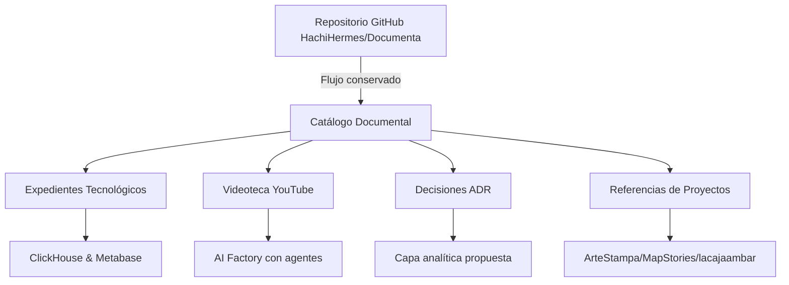

# DOCUMENTA · Resumen consolidado del repositorio

## En una frase
Biblioteca tecnológica para descubrir y evaluar herramientas antes de incorporarlas a proyectos, con flujo conservado: Descubrir → Evaluar → Probar → Medir → Integrar con aprobación.

## Contexto
Documenta es infraestructura documental compartida que conserva investigaciones, referencias y criterios para incorporar herramientas. No es un proyecto de producto ni almacén de datos de las aplicaciones. Cada proyecto mantiene su código y documentos canónicos en su repositorio; aquí se enlazan, no se duplican completos.

## Arquitectura en sencillo
1. **Entrada:** Contenido del repositorio /opt/data/Documenta (URL: https://github.com/HachiHermes/Documenta)
2. **Procesamiento:** Análisis de documentos Markdown, catálogos, expedientes técnicos y decisiones (ADR)
3. **Almacenamiento:** Resumen estructurado en bullets y documentación formal
4. **Comunicación:** Exportación a repositorio local con flujo de incorporación conservado
5. **Observación:** Sin incautar secretos, datos personales, volcados ni respaldos

## Diagrama

## Componentes

| Componente | Responsabilidad | Tecnología | Dependencias | Riesgos |
|------------|----------------|------------|--------------|---------|
| Catálogo documental | Inventario y clasificación de herramientas | Markdown, Git | Flujo de incorporación | Pérdida de contexto si no se sigue flujo |
| Expedientes TEC | Análisis de viabilidad tecnológica | MD, reposorios externos | Aprobación de Luis | Decisiones sin fundamentar |
| Decisiones ADR | Propuestas de arquitectura | MD, contexto de proyectos | Revisión profesional | Postergar capacidades necesarias |
| Referencias proyectos | Enlaces a repositorios canónicos | URLs GitHub | Contexto parcial | Confundir con código propio |
| Videoteca YouTube | Índice y análisis de vídeos | YouTube, MD | Permisos de contenido | Contenido externo inaccesible |

## Decisiones clave

| Decisión | Alternativas | Motivo | Consecuencias |
|----------|-------------|--------|---------------|
| Mantener flujo conservado | Acelerar sin evaluación | Evitar incautación de secretos/datos | Menor riesgo, incorporación más lenta |
| PostgreSQL como base inicial | ClickHouse primero | Capacidad analítica ≠ necesidad actual | Menor coste inicial, escalar después si es necesario |
| Enriquecer catálogo con expedientes | Catálogo vacío | Documentar antes de decidir | Mejor información para decisiones futuras |
| Preservar fondo histórico | Auditar y limpiar | No sanea contenido no verificado | Mantener historia, asumir riesgo de contenido no revisado |

## Flujos principales

### Flujo: Incorporación de herramienta nueva
1. Paso: Descubrir enlace o idea relacionada con proyecto
2. Paso: Evaluar seguridad, privacidad y dependencia
3. Paso: Probar en piloto aislado (no autoriza despliegue)
4. Paso: Medir coste, calidad y utilidad
5. Paso: Integrar con aprobación (si corresponde)
6. Resultado esperado: Decisión informada, no adopción ciega
7. Fallos y recuperación: Si el piloto falla, registrar lecciones, no repetir error

### Flujo: Decisión sobre nueva investigación
1. Paso: Identificar necesidad o pregunta de decisión
2. Paso: Consultar referencias y expedientes existentes
3. Paso: Aplicar plantilla TEC-AAAA-NNN
4. Paso: Documentar hecho vs hipótesis
5. Paso: Definir criterios de aceptación y pilotaje
6. Resultado esperado: Investigación con estado y recomendación claros
7. Fallos y recuperación: Si no hay suficientes datos, marcar como "por confirmar"

## Datos y contratos

- **Entidades:** Repositorios GitHub (HachiHermes/*, Documenta), expedientes TEC, decisiones ADR
- **Fuentes de verdad:** Contenido de archivos Markdown en /opt/data/Documenta/docs/
- **Eventos o APIs relevantes:** Git operations (commit, pull request, issue), lecturas de archivos
- **Reglas de negocio:** Flujo conservado, sin incautar secretos, preservar fondo histórico

## Riesgos y limitaciones

| Riesgo | Impacto | Mitigación | Propietario |
|--------|---------|------------|-------------|
| Incautar secretos/datos personales | Compromiso de privacidad | Política explícita: no incorporar secretos | Administración Documenta |
| Decisiones sin fundamentar | Incorporación de herramientas innecesarias | Requerir expediente TEC completado | Responsable aprobación |
| Postergar capacidades necesarias | Falta de herramientas cuando se necesiten | Evaluar periodicidad, no bloquear permanently | Luis (aprobador) |
| Confundir repositorio propio con código canónico | Duplicación no intencionada | Enlaces relativos, no copiar completos | Administración Documenta |
| Contenido no auditado en fondo histórico | Creer que está validado | Aclarar que no se ha auditado | Administración Documenta |

## Preguntas abiertas

- ¿Cuándo es el momento adecuado para pasar de PostgreSQL a ClickHouse basándose en mediciones reales?
- ¿Qué umbral de volumen de datos justifica la ingesta dual PostgreSQL→ClickHouse?
- ¿Cómo garantizar que el fondo histórico preservado no sea confundido con contenido auditado?
- ¿Qué proyectos nuevos deberían incorporarse al catálogo y cuándo?
- ¿Con qué frecuencia deben revisarse las decisiones ADR pendientes?
- ¿Cómo comunicar el principio "no es una base de datos de negocio" a nuevos miembros del equipo?

## Fuentes y citas

- [DOCUMENTA README](https://github.com/HachiHermes/Documenta) — consultado el 2026-11-15
- [Catálogo documental](https://github.com/HachiHermes/Documenta/blob/main/docs/00-biblioteca/catalogo.md) — consultado el 2026-11-15
- [Organización y conservación](https://github.com/HachiHermes/Documenta/blob/main/docs/00-biblioteca/organizacion.md) — consultado el 2026-11-15
- [ADR-001 · Capa analítica propuesta](https://github.com/HachiHermes/Documenta/blob/main/docs/20-decisiones/ADR-001-capa-analitica-propuesta.md) — consultado el 2026-11-15
- [Referencias de proyectos](https://github.com/HachiHermes/Documenta/blob/main/docs/30-proyectos/referencias.md) — consultado el 2026-11-15
- [Plantilla de investigación](https://github.com/HachiHermes/Documenta/blob/main/docs/00-biblioteca/plantilla-investigacion.md) — consultado el 2026-11-15
- [flujo de incorporación conservado](https://github.com/HachiHermes/Documenta/blob/main/README.md#flujo-de-incorporacion-conservado) — consultado el 2026-11-15
